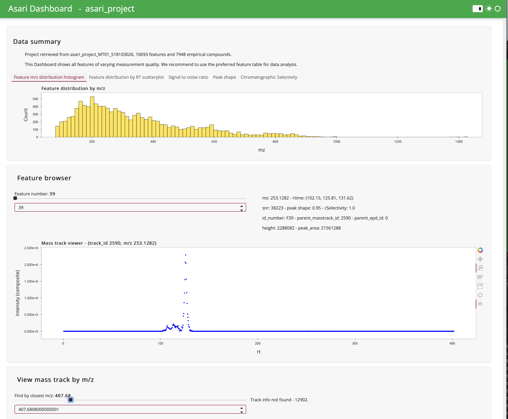
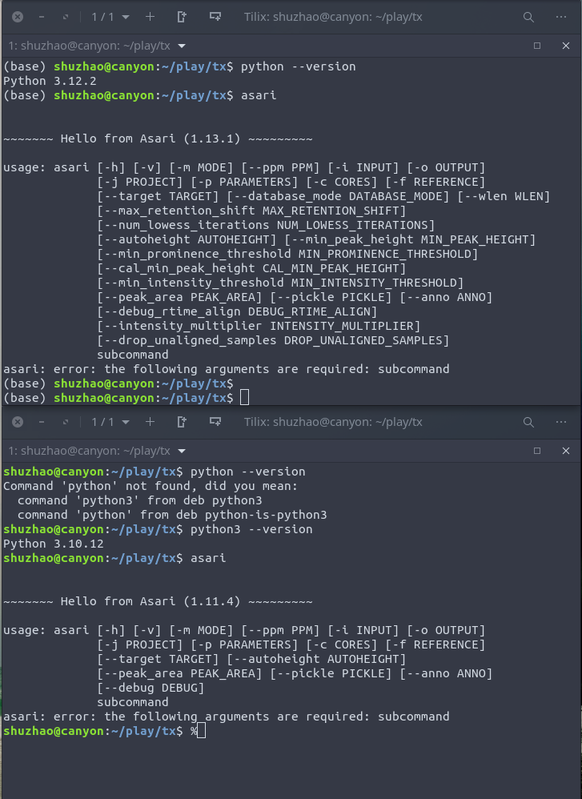

# Asari Guide

In-depth information on asari: workflows, parameters, output, algorithms and data formats.
For installation and a quick start with the table of workflows, see [README.md](README.md).

- [Design](#design)
- [Input and data inspection](#input-and-data-inspection)
- [LC-MS](#lc-ms)
- [GC-MS](#gc-ms)
- [LC-MS/MS and MS/MS](#lc-msms-and-msms)
- [DI-MS](#di-ms)
- [Joining results](#joining-results)
- [Dashboard](#dashboard)
- [Output](#output)
- [Parameters](#parameters)
- [Algorithms](#algorithms)
- [Data formats](#data-formats)
- [Algorithmic topics](#algorithmic-topics)
- [Performance](#performance)
- [Platforms, Anaconda and Docker](#platforms-anaconda-and-docker)
- [Discussion and future plans](#discussion-and-future-plans)
- [Extensions and notebooks](#extensions-and-notebooks)

## Design

Asari is a trackable and scalable program for high-resolution metabolomics data processing:

- Taking advantage of high mass resolution to prioritize mass separation and alignment
- Peak detection on a composite map instead of repeated on individual samples
- Statistics guided peak detection, based on local maxima and prominence, selective use of smoothing
- Reproducible, track and backtrack between features and mass tracks (EICs)
- Tracking peak quality, selectivity metrics on m/z, chromatography and annotation databases
- Scalable, performance conscious, disciplined use of memory and CPU
- Transparent, JSON centric data structures, easy to chain other tools

Annotation is separate from feature extraction. Subcommands do one step each and pass files to the next:
`process` (feature extraction), `deconvolute` (grouping features into empirical compounds or pseudospectra),
`annotate` (database and library search), `join` (combining results), `viz` (dashboard) and `peek` (single-file inspection).
Different methods of annotation can be applied to the same data and combined by `join`.
No database is used in `process`.

An example pipeline is [PCPFM](https://pypi.org/project/pcpfm/), which includes data processing, annotation, QC and data wrangling, plus Thermo raw file conversion.

## Input and data inspection

Input data are centroided mzML files. Example datasets are at https://github.com/shuzhao-li-lab/data.
We use ThermoRawFileParser (https://github.com/compomics/ThermoRawFileParser) to convert Thermo .RAW files to .mzML.
Msconvert in ProteoWizard (https://proteowizard.sourceforge.io/tools.shtml) can handle most vendor formats and .mzXML files.
Profile mode data should be centroided first (e.g. msconvert `--filter "peakPicking vendor msLevel=1-"`); asari does not centroid.

Input is a directory of mzML files (`-i`), or a text file listing mzML paths, one per line (`--files`).

`asari peek -i file.mzML` returns a summary on a single mzML file: numbers of MS1 and MS/MS spectra, ionization mode, retention time and m/z ranges, mass tracks, 12C/13C isotopic pairs as landmarks and their intensity range (useful to set `min_peak_height`).
Mass accuracy is estimated by matching landmark m/z values to reference values in `asari/db/calibration_mz.json` (or `--db`, same format).
If matplotlib is available, a scan sequence plot (`tools.plot_scan_seq.plot_msn`) is written to `<project>_peek_<time stamp>/<file>_peek.pdf`.

`asari process --autoheight T` estimates `min_peak_height` from landmark tracks of a few input files.

`calibration_mz.json` holds reference m/z values for positive and negative modes ({"pos": [...], "neg": [...]}): [M+H]+ / [M-H]- of compounds in the KEGG global metabolic map (map01100) and the top 2000 CSM consensus mass registries by KDE density, merged within 2 ppm.

## LC-MS

### Feature extraction

`asari process -i mydir/projectx_dir` processes all mzML files under the directory with the default LC workflow; only MS1 data are used.
Intensity of features in each sample is peak area, by `--peak_area sum` (default, simple sum), `auc` (area under curve) or `gauss` (Gaussian fit).
See [Algorithms](#algorithms) for the steps.

### Pre-annotation (deconvolute)

`asari deconvolute -i Feature_table.tsv --workflow LC` groups isotopes and adducts of the same compound into empirical compounds (empCpds), using [khipu](https://github.com/shuzhao-li-lab/khipu). This is also called pre-annotation; no database is used.
Adducts follow `adduct_search_patterns_pos/neg` in `default_parameters.py` (neg mode includes Cl- and formate), with RT tolerance `khipu_rtime_tolerance` (seconds).
Output in `<project>_deconvolution_<time stamp>/`: `<project>_list_khipus.json` (list of empCpds) and `<project>_list_khipus.tsv` (one row per feature, with empCpd, isotope and ion; features not in any khipu are listed as singletons).

### Annotation

`asari annotate -i Feature_table.tsv --workflow LC` matches features to a compound database or library:

- `--search_algorithm mz` (default for LC): m/z match within `mz_tolerance_ppm`. The database is a JSON list of compounds with `monoisotopic_molecular_weight` or `neutral_formula_mass`; each compound is expanded to ions M+H+ (or M-H-) plus the adducts in `adduct_search_patterns_pos/neg`, labelled as khipu modifications. Default database: built-in `asari/db/core_blood_metabolites_20250212.json`.
- `--search_algorithm rtmz`: m/z and RT match within `--lc_rt_tolerance` (seconds, default 10), to a library of features with `mz` and `rtime`, e.g. authentic chemical standards or MS/MS search results. Default library: built-in `asari/db/v3_authlib2024_hilicpos.json`.
- `--preannotation <deconvolute result>`: a `_list_khipus.json` file or its directory. Library matches are combined within each empCpd: matches consistent with the empCpd neutral mass are kept, M0 and more common ions (M+H+/M-H- first, then adduct order) are prioritized in conflicts, and the selected matches are assigned to all features of the empCpd. If no match is consistent with the empCpd neutral mass, features keep their direct matches.

Multiple matches per feature are kept (e.g. isomers, or a compound matched to features at different RT); results of different methods are combined and curated by `join --join_algorithm annotation_combine` (see [Joining results](#joining-results)).
Output in `<project>_annotation_<time stamp>/`: `Features_<project>.tsv` (one row per feature–library match, with `match` as `direct` or `empCpd`) and `Annotated_features_<project>.json`.

## GC-MS

GC-MS uses `--workflow GC` in three steps: `process` (feature extraction), optional `deconvolute` (grouping features into pseudospectra) and `annotate` (library search).

**Retention index (RI).** Matching to libraries uses Kovats retention index. Provide alkane standards as a tab-separated file with a header row and two columns, Kovats index and measured retention time in minutes (example: `test/KovatsIndex_alkanestandards_cuimc.tsv`). RI is interpolated from feature retention time by a lowess fit to the standards; features eluting outside the standards get the RI of the nearest end.

To process GC-MS data and add an `RI` column to the feature table (right after `detection_counts`):

```
asari process -i mydir/gc_project --workflow GC --kovats KovatsIndex_alkanestandards.tsv
```

Feature tables that already have an RI column (named `RI`, `Retention Index`, `Kovats_RI`, etc.) do not need `--kovats` in the steps below. Otherwise, pass `--kovats` to `deconvolute` or `annotate`.

To annotate a feature table by reverse search (default; recommended for high-resolution data). Library spectra are matched to features within m/z and RI windows:

```
asari annotate -i gc_project/Feature_table.tsv -o gc_project -j gc_anno \
    --workflow GC --db my_GCMS_library.msp
```

To deconvolute a feature table into pseudospectra (`--deconvolution_algorithm`: `hcl`, the default, clustering by correlation across samples and RI; `adap`, a port of ADAP-GC; or `nmf`, as in MSHub). The results are written to JSON and MSP:

```
asari deconvolute -i gc_project/Feature_table.tsv -o gc_project -j gc_decon \
    --workflow GC --deconvolution_algorithm adap
```

To annotate pseudospectra by forward search against a library. Use `--hires F` for unit-mass (low-resolution) data or libraries:

```
asari annotate -i gc_decon_denovo_pseudospectra.json -o gc_project -j gc_fwd \
    --workflow GC --search_algorithm forward --db my_GCMS_library.msp
```

Forward search can also start from a feature table, which then runs deconvolution first (`--search_algorithm forward --deconvolution_algorithm nmf`).
High-resolution forward search uses batch entropy open search (`asari.ms2batch`), filtered by RI window and matched peaks, then cosine on the top hits; unit-resolution search uses cosine on unit m/z.

Notes:
- `--db` takes MSP or JSON. Common MSP field-name variants are recognized; RI is read from `RI`, `Retention_index`, `Kovats` etc., or from `RETENTIONTIME` as in some GC libraries. Library entries without RI are not used. Without `--db`, the built-in `asari/db/gcms_corelib_20260930.msp` is used. A small low-resolution test library is at `asari/db/lowres_test_gcms.msp`.
- Search parameters (`ms2_tolerance_in_da`, `ri_tolerance`, `score_cutoff_cosine`, `score_cutoff_entropy`, `corr_cutoff`) can be set in a parameter file (`-p`); `--score_cutoff_cosine` also on command line.
- Annotation outputs: `empCpds_<project>.tsv` (one row per annotated compound), `Features_<project>.tsv` (one row per annotated feature), `Annotated_pseudospectra_<project>.json` and `.msp`. PDF mirror plots under `mirrorplots/` are optional (`--mirror_plot T`); interactive mirror plots are in the dashboard (`asari viz -i <annotation directory>`).

## LC-MS/MS and MS/MS

### Processing

LC-MS/MS (DDA) data produce an MS1 feature table and MS/MS spectra on mass tracks:

```
asari process --mode pos --input mydir/projectx_dir --workflow LCMSMS
```

MS/MS spectra are clustered per composite mass track (default greedy clustering with consensus spectra, `ms2_cluster_method` in parameters) and exported to `ms2_spectra.json` and `.msp`. Use `--cluster_ms2 F` to skip clustering and export unclustered spectra per input file as `ms2_spectra_<sample>.msp`.
The MS1 feature table and MS/MS clusters are reported separately, sharing mass track IDs.

To extract MS/MS spectra only, ignoring MS1 data (no mass tracks, no m/z or RT alignment):

```
asari process --input mydir/projectx_dir -o mydir -j msms_project --workflow MSMS
```

By default, MS/MS spectra of all input files are grouped by precursor m/z (within `mz_tolerance_ppm`), then clustered on RT and spectral similarity as in LCMSMS, and exported to `ms2_spectra.json` and `.msp`. Use `--cluster_ms2 F` to export unclustered spectra per input file as `ms2_spectra_<sample>.msp`. Clustering reduces data size greatly on large cohorts, less so on small experiments.

### Annotation

```
asari annotate --db mydir/MSMS_library.npz -i mydir/projectx_dir/ms2_spectra.json -o mydir/projectx_dir/ --workflow LCMSMS
```

`--workflow MSMS` is the same. Input spectra can be `ms2_spectra.json`, `.msp`, or the process result directory.
Query spectra are searched by entropy similarity (identity search, precursor within `lcmsms_ms1_tolerance_in_da`, fragments within `lcmsms_ms2_tolerance_in_da`); cosine similarity is computed on the best entropy match.
Matches pass by `--score_algorithm` (cosine, default, or entropy) with `--score_cutoff_cosine` (default 0.4) or `score_cutoff_entropy`. Redundant library compounds (same InChIKey, else name) are collapsed to the best match.
Results are written to `<project>_MS2_annotation.tsv` and `.json` in `<project>_annotation_<time stamp>/`; the JSON includes experimental and library peaks for mirror plots in the dashboard.

The database (`--db`), by file extension:

- `.npz` (recommended): a spectral index of `asari.ms2batch`, searched in batch mode (vectorized, NumPy only).
- `.msp`, `.mgf`, `.json`: plain spectra, indexed in memory then searched in batch mode.
- `.pkl`: legacy FlashEntropySearch pickle, searched per spectrum. Pickle files are not secure to share; convert them to `.npz`.

Both search modes give the same scores.

MS1 annotation of the LC-MS/MS feature table is the same as in LC-MS: `--workflow LCMSMS --search_algorithm mz` (or `rtmz`) is a shortcut that runs as `--workflow LC`, with `-i` the feature table or the process result directory (using its `Feature_table.tsv`). The CLI prints a note when the shortcut is used, and `project.json` records `workflow: LC`.

```
asari annotate -i mydir/dda1_<ts> -o mydir -j dda1 --workflow LCMSMS --search_algorithm mz
```

### Indexing an MS/MS library to .npz

MS/MS search uses entropy similarity (Li et al. 2021), by the batch search in `asari.ms2batch` on `.npz` spectral indexes.
Build an index once from an MSP, MGF or JSON library, then use the `.npz` file as `--db`:

```
python -m asari.ms2batch index MassBank_NISTformat.msp MassBank.npz
asari annotate --workflow LCMSMS --db MassBank.npz -i projectx_dir/ms2_spectra.json -o projectx_dir
```

Peaks are cleaned as in MS Entropy (precursor ion removal, noise filter at 1% of base peak, centroiding at 0.05 Da), so scores are comparable to FlashEntropySearch. Options: `--precursor-removal-da` (default 1.6; negative to disable, e.g. for EI spectra), `--noise-threshold` (default 0.01), `--min-peak-distance` (default 0.05), `--unweighted` (no entropy intensity weighting), `--no-metadata` (smaller file, without names and other fields). See `python -m asari.ms2batch index -h`.

The `.npz` file is a plain NumPy archive (no pickle), safe to share and loaded with `allow_pickle=False`; it can be memory-mapped for large libraries. In Python:

```
from asari.ms2batch import SpectralIndex, read_spectra
index = SpectralIndex.build(read_spectra('library.msp'))
index.save('library.npz')
index = SpectralIndex.load('library.npz')
```

A legacy FlashEntropySearch pickle can be converted by `python -m asari.ms2batch index library.pkl library.npz`. Unpickling can execute code, so convert only trusted files.

## DI-MS

`asari process --workflow DIMS` processes direct infusion data: mass tracks are aligned into a MassGrid, without RT alignment or peak detection, and the feature table reports the max intensity per mass track per sample.
DI-MS data often have lower intensities than LC-MS; consider a lower `--min_peak_height` (e.g. by checking `asari peek`).

## Joining results

To join data from multiple feature tables using the same LC/GC-MS method, e.g. batches or parallel processing of a large dataset:

`asari join -i pathlist.txt -o OUTDIR -j project_name`

The input for `join` is a list of project directories or paths to feature tables (`Feature_table.tsv`), each a result of asari processing.
This uses the default `--join_algorithm composite_table_merge`, which simulates full feature detection; results are in `join_<project>_<time stamp>/asari_join_result.tsv`.

To combine GC annotation results from different runs or methods on the same feature table (e.g. reverse search, and forward search on different deconvolutions or libraries):

`asari join -i annotation_list.txt -o OUTDIR -j project_name --workflow GC --join_algorithm annotation_combine`

The input is a text file listing `Annotated_pseudospectra_*.json` files or annotation directories, one per line. Annotations are combined by feature IDs and compound identity (first block of InChIKey by default, `combine_inchikey_block` in parameters; name if no InChIKey): annotations of the same compound sharing any feature are merged, the one of highest cosine score as representative. Output is the same set of files as GC annotation (`Annotated_pseudospectra_`, `empCpds_`, `Features_` and MSP), with sources and number of supporting sources per empCpd; the result directory can be viewed by `asari viz`.

To combine LC-MS annotation results of the same process run, MS1 annotation (`annotate --workflow LC`, `mz` or `rtmz`, on one or more databases), MS/MS annotation (`annotate --workflow LCMSMS` or `MSMS`, on one or more libraries) and preannotation (`deconvolute --workflow LC`, khipu):

`asari join -i lc_results.txt -o OUTDIR -j project_name --workflow LC --join_algorithm annotation_combine`

The input is a text file listing result directories, one per line, e.g.

```
/data/u2c_1116114510
/data/u2c_cpdlib_annotation_1116114949
/data/u2c_csm_annotation_1116121332
/data/u2c_khipu_deconvolution_1116115934
/data/u2cmsms_massbank_annotation_111612220
/data/u2cmsms_msdial_annotation_111612545
```

Each directory is identified by its `project.json` (`run`, `workflow`), which also decides the file to use: `Feature_table.tsv` and `ms2_spectra.json` from `process`, `*_list_khipus.json` from `deconvolute`, `Annotated_features_*.json` from LC `annotate`, `*_MS2_annotation.json` from LCMSMS/MSMS `annotate`. The process directory can be omitted if all other runs share it as input. Sources are verified to come from the same process run (input of each run, ionization mode, feature IDs and feature count); inconsistent sources are excluded with a warning.

Combination rules:
- MS1 direct matches from all databases are pooled. With preannotation, matches are combined within each empirical compound as in `annotate --preannotation`: candidates consistent with the empCpd neutral mass, M0 over isotopes, then more common ions; the selected annotation is assigned to all features in the empCpd (`match: empCpd`).
- MS/MS spectra are mapped to MS1 features by parent mass track (or precursor m/z within `mz_tolerance_ppm`) and retention time: a feature whose peak range contains the MS/MS RT is preferred, else the closest within `lc_rt_tolerance`. MS/MS annotations are added to the mapped feature (`match: direct`) and to other features of its empCpd (`match: empCpd`). Spectra without a matching MS1 feature are kept in the MS/MS output with an empty `feature`.
- `number_of_sources` counts sources (databases or libraries) supporting the same compound on a feature, compared by InChIKey (first block, `combine_inchikey_block`) or name.

Output, in `<project>_annotation_combine_<time stamp>/`:
- `<project>_MS2_annotation.tsv` and `.json`: all MS/MS annotations, with source, mapped feature and empCpd; the directory can be viewed by `asari viz` (mirror plots).
- `Features_<project>.tsv` and `Annotated_features_<project>.json`: annotated MS1 features, one tsv row per annotation, with `evidence` (MS1 or MS2), `match`, `source`, `number_of_sources`, library fields, and MS/MS scores for MS2 evidence.

## Dashboard

`asari viz --input <directory>` launches a dashboard in the web browser (requires the `viz` extra). The dashboard type is determined by `run` in `<directory>/project.json`.

Processed results (`run: process`, LC or GC workflow). Users can inspect features, composite mass tracks, co-eluting features and RT alignment. This requires `asari process ... --diagnosis True`, which exports `cmap.pickle` (large, not exported by default). The dashboard uses these files under the result folder: 'project.json', 'cmap.pickle' and 'Feature_table.tsv' (projects from earlier versions, with these files under `export/`, are also read). Thus, one can move around the folder, but modification of these files is not a good idea. Please note that pickle files are for internal use, and one should not trust pickle files from other people.

Annotation results (`run: annotate`, GC, LCMSMS or MSMS workflow, or `annotation_combine` of GC or LC with MS/MS), e.g. `asari viz -i mydir/myproject_annotation_1112115116`. The dashboard reads annotated spectra from `Annotated_pseudospectra_*.json` (GC) or `*_MS2_annotation.json` (LCMSMS, MSMS). It has a summary panel (scores, matched peaks, distribution by RT/RI and m/z), and a browser of all annotations with interactive mirror plots, experimental spectrum (peaks or peaks_as_features) vs library spectrum (peaks_in_lib). Peaks matched within the annotation m/z tolerance are marked. LC (MS1) annotation is not shown in the dashboard.



## Output

A run of `process` creates a project directory `<project_name>_<time stamp>` under the output directory (`-o`, default current directory). E.g. `-o mydir -j rsvstudy` may generate `mydir/rsvstudy_427105156` like this

    rsvstudy_427105156
    ├── README.txt
    ├── Feature_table.tsv
    ├── pickle
    │   ├── Blank_20210803_003.pickle
    │   ├── ...
    └── project.json

There is one feature table, `Feature_table.tsv`, under the project directory (since asari 2.0; earlier versions had `preferred_Feature_table.tsv` and `export/full_Feature_table.tsv`).
Sample intensities are integers.

All peaks are kept in `Feature_table.tsv` if they meet signal (snr) and shape standards
(part of input parameters but default values are fine for most people).
That is, if a feature is only present in one sample, it will be reported,
as we think this is important for applications like exposome and personalized medicine.
The filtering decisions are left to end users, e.g. by `snr`, `goodness_fitting` (peak shape), `cSelectivity`, `detection_counts` or annotation.

With `--diagnosis True`, `_mass_grid_mapping.csv` and `cmap.pickle` (used by `asari viz`) are also written. LCMSMS and MSMS workflows write MS/MS spectra to `ms2_spectra.json` and `.msp` (or `ms2_spectra_<sample>.msp` per input file with `--cluster_ms2 F`); MSMS has no feature table.

An example feature table (from an earlier version, filtered as the then preferred table) is `test/HighOnly_HILICpos_preferred_Feature_table.tsv`, which was generated by:
    `asari process -i MT202304_2phase_HILICpos -o highonly --min_peak_height 1000000`

The `pickle` folder keeps intermediate files during processing.
They are removed after the processing by default, to save disk space; set `keep_intermediates: True` in a parameter file (`-p`) to keep them.

Other subcommands write to `<project>_deconvolution_<time stamp>/`, `<project>_annotation_<time stamp>/`, `join_<project>_<time stamp>/` or `<project>_annotation_combine_<time stamp>/`, each with a `project.json` recording parameters.

## Parameters

In most cases, only `mode` and `mz_tolerance_ppm` require attention. The latter is set at 5 ppm by default. Most modern instruments are fine with 5 ppm, but one may want to change if needed.

Default ionization mode is `pos`. Change to `neg` if needed, by specifying `--mode neg` in command line.

Users can supply a custom parameter file `xyz.yaml`, via `--parameters xyz.yaml` in command line.
A template YAML file can be found at `test/parameters.yaml`. All parameters and defaults are in `asari/default_parameters.py`.

When the above methods overlap, command line arguments take priority.
That is, commandline overwrites `xyz.yaml`, which overwrites default asari parameters in `default_parameters.py`.

## Algorithms

### Overview

- From each mzML data file, mass tracks of unique MS1 m/z values are extracted, then aligned into a MassGrid.
- MS2 spectra, when present, are attached to mass tracks.
- Retention time is calibrated for each sample to a common reference sample.
- For each m/z value, corresponding mass tracks from all sample files are summarized into one composite mass track.
- Elution peak detection is performed on the composite mass tracks to generate a feature list for the experiment.
- The features are mapped back to each sample to extract peak area as intensity values.

The approach of MassGrid and composite mass tracks is highly scalable.
This is different from the traditional approach, where peak detection is performed per sample upfront,
followed by retention time alignment and correspondence.

Basic data concepts follow https://github.com/shuzhao-li/metDataModel, organized as

    ├── Experiment
       ├── Sample
           ├── MassTrack
               ├── Peak
               ├── Peak
           ├── MassTrack
               ├── Peak
               ├── Peak
        ...
       ├── Sample
        ...
       ├── Sample

A sample here corresponds to an injection file in LC-MS experiments.
A MassTrack is an extracted chromatogram for a specific m/z measurement, governing full retention time.
Therefore, a MassTrack may include multiple mass traces, or EICs/XICs, as referred by literature.
Peak (an elution peak at specific m/z) is specific to a sample, but a feature is defined at the level of an experiment after correspondence.
A major difference to proteomics is that a feature in LC-MS metabolomics is defined by m/z and retention time across one experiment.
We use `empirical compound` to group degenerate features into a tentative compound/metabolite.

Additional details:
- Use of MassTracks simplifies m/z correspondence, which results in a MassGrid
- Two modes of m/z correspondence: a clustering method for studies >= N (default 10) samples;
    and a slower method based on landmark peaks and verifying mass precision.
- Chromatogram construction is based on m/z values via flexible bins and frequency counts (in lieu histograms).
- Elution peak alignment is based on LOWESS
- Use integers for RT scan numbers and intensities for computing efficiency
- Avoid mathematical curves whereas possible for computing efficiency

Selectivity is tracked for
- mSelectivity, how distinct are m/z measurements
- cSelectivity, how distinct are chromatograhic elution peaks

### Data processing step by step

1. Build sample registry; see `process.process_project`, `process.register_samples`.

2. Mass track construction for each sample; see `chromatograms.extract_massTracks_`.

   a. Get all MS1 spectra from a data file, as a list of [(m/z, scan number, intensity), ...]. Index to a dictionary by int(mz * 1000) for efficient retrieval. This is an mzTree.

   b. Create a list of data bins from mzTree. Each bin starts with a value in the mzTree, which has a m/z range around 0.001 and is filtered by minimal required scan number. If two bins are adjacent by 0.001 or within tolerance ppm, they are merged. See `chromatograms.get_thousandth_bins`.

   c. Build mass tracks per data bin. If the m/z range in a data bin is within 2 x tolerance ppm, the bin leads to a single mass track.

   Else, a nearest neighbor (NN) clustering is performed to establish the number of mass tracks. The NN clustering assigns each data point to its nearest "peak mz value". The "peak mz values" are determined by finding peaks in the m/z value distribution, with the requirement that the two peaks need to be separated by the mz tolerance minimally. The m/z value distribution is approximated by a histogram for computing efficiency. See `mass_functions.nn_cluster_by_mz_seeds`.

    A mass track is defined by a consensus m/z value and a list of intensity values. The consensus m/z value is taken as the mean of (median m/z and the m/z at highest intensity). This avoids instable values caused by outliers. When multiple data points exist in the same scan (same RT), max intensity is used. This cleans up duplicate mass peaks from the centroiding process. The mass track is of full RT range, with zeros inserted where intensity is missing. See `chromatograms.extract_single_track_fullrt_length`.

   d. Establish anchor mass tracks by finding m/z differences that match to either 13C/12C isotopes or Na/H adducts. These anchors are considered of higher confidence and prioritized in m/z alignment.

   e. For all samples, use parallel processing; See `process.batch_EIC_from_samples_`.

3. Alignment of mass tracks across samples, resulting in the MassGrid; See `CompositeMap.construct_mass_grid`.

   a. The sample with the highest number of anchor mass tracks is designated as the reference sample, unless a user specifies a reference sample via input parameters. See `ext_Experiment.get_reference_sample_id`.

   b. If the sample number is no more than a predefined parameter ('project_sample_number_small', default 10), this is considered a small study and a pairwise alignment is performed. When a new sample is aligned to the reference list of m/z values (initially from the reference sample), the anchor mass tracks are compared and mapped first. If there is a systematic difference greater than a preset value (default 1 ppm), all m/z values in the sample are recalibrated against the reference. Because the anchors are of higher confidence and mostly have well resolved m/z values, their alignment has less chance for errors. By completing the alignment of anchors first, the remaining m/z values (significantly fewer than the total features) do not compete against the anchors during their alignment, leading to cleaner results. See `MassGrid.build_grid_sample_wise`, `MassGrid.add_sample`.

   c. Else, for a larger study, the mass alignment is performed by the same NN clustering method that is used in initial mass track construction. See `MassGrid.build_grid_by_centroiding`, `MassGrid.bin_track_mzs`

4. Retention time alignment

   a. The reference sample was established prior to mass alignment. A set of landmark elution peaks are determined in this reference sample by the criteria: mSelectivity > 0.99, min_peak_height is satisfied (default 1e5), prominence > 20% of peak height and the peak is the only peak on its mass track. These are our "selected_reference_landmark_peaks". See `set_RT_reference`, `peaks.quick_detect_unique_elution_peak`.

   b. For each of the remaining samples, a set of good peaks are selected using the same criteria as above, but limited to from the mass tracks already aligned to the selected_reference_landmark_peaks. They constitute the "good_landmark_peaks" specific to a sample. See `CompositeMap.calibrate_sample_RT`.

   c. Perform a LOWESS (Locally Weighted Scatterplot Smoothing) regression to obtain a function to describe the relationship of the RT values between good_landmark_peaks and selected_reference_landmark_peaks. To prevent spurious results from the regression, we add 10% extension out of both ends as boundaries that the regression must converge to. In practice, the function extrapolates to a dictionary to map all scan numbers between the current sample and the reference sample. The dictionary skips numbers that are identical between the two samples to save memory and computing. The resulting "rt_cal_dict" is a correspondence between sample_rt_numbers and reference_rt_numbers. See `chromatograms.rt_lowess_calibration`

   d. Loop through all remaining samples to obtain the RT calibration function (rt_cal_dict) per sample.

5. Building the composite map

   a. Now that we have established both the m/z alignment in MassGrid and RT alignment between samples, they are linked in the `CompositeMap` class.

   b. Each LC-MS feature should be on a specific location on the composite map (with a consensus m/z and RT). A feature can be conceptualized as a pattern that is repeated in multiple samples. Thus, the pattern will persist and be even enhanced when the signals from multiple samples are superimposed. This concept is implemented into "composite mass tracks", where the intensity values are summed on corresponding mass tracks across all samples after RT calibration. The mass tracks are intensity vectors of the same length, based on scan numbers, after retention time alignment. See `CompositeMap.build_composite_tracks`.

6. Detection of elution peaks (features)

   Instead of detecting the same peaks in every sample, asari detects an elution peak only once on the composite mass tracks. Because a composite mass track represents all samples, an elution peak here is equivalent to a feature in the experiment. The shape and prominence of a peak matter in relation to its surroundings. Some instruments generate higher intensity numbers than others arbitrarily. The absolute intensity number is not the most important; a peak is distinctive as long as its shape is good and its height is well above the noise level. We may state that all good peaks look similar. It is the "scaling" factor that differs between metabolites and between platforms. The peak detection in asari is largely dependent on the noise levels. The default parameters are functional over a large range and updated based on statistical analysis of the mass track. See `peaks.audit_mass_track`, `peaks.stats_detect_elution_peaks`.

   a. If the max intensity of a mass track is higher that a preset ceiling (1E8), the mass track is rescaled under the preset ceiling for the purpose of peak detection. This serves a normalization purpose to make peak detection parameters robust. Because the composite mass tracks sum up the cumulative intensity of all samples, the intensity could be exceedingly high in large studies. But the detection of elution peaks on composite mass tracks only needs to determine the apex and peak boundaries. The useful quantitative value is the peak area reported on individual samples, not on a composite mass track. After peak detection, the peak height is scaled back using the same scaling factor.

   b. If the median intensity on a mass track is below the preset min_intensity_threshold (default 1e3 for Orbitrap data), this is a low-intensity track. Both baseline level and noise level are set to min_intensity_threshold.

   c. Else, if over half the data points are above min_intensity_threshold and the median intensity is higher than 10 times of preset min_peak_height (default 1e5 for Orbitrap data), detrend (scipy.signal.detrend) is performed on the mass track. Detrend is a regression method to ensure the baseline is not significantly rising or decreasing over the chromatography. It is a computationally expensive operation and only required for high-signal and high-noise data.

   d. If a track is not low-intensity (see b), the bottom signals are taken as intensity values below the lower quartile plus min_intensity_threshold. The constant of min_intensity_threshold makes this method stable, even when zeros dominate the track. Here, the baseline level and noise level are assigned as the mean and standard deviation of the bottom signals, respectively.

   e. Smoothing (chromatograms.smooth_moving_average) is applied when the noise level is higher than 1% of max intensity and max intensity is lower than 10 times of the preset min_peak_height. For low noise or high intensity tracks, smoothing is not needed.

   f. The mass track is subtracted by a filter (i.e. baseline + noise level). This creates multiple segments of positive intensity values, because some data points are below the filter. Peak detection is performed on the separate regions, because i) it is faster to skip very low signals, ii) this reduces the chance of dealing with multiple peaks simultaneous, and iii) this allows further determination of proper peak prominence based on local signal levels.

   g. Peak detection on a segment of signals. Asari uses a simple local maxima method (scipy.signal.find_peaks), with prominence control that is dynamically determined on each mass track then each segment. Prominence is the vertical distance from a peak top to its lowest contour line. Prominence is calculated in a series of steps: the initial value is 1/3 of min_peak_height; then the greater of prominence and the noise level of a track is used as the new prominence; if the segment is high-intensity and high-noise, the greater of prominence and 5% of max intensity is used as the new prominence. Another parameter, min_peak_height, applies to this method. The parameter min_timepoints is used for controlling both distance between peaks and peak width. The prominence is computed on a sliding window size (default 25 scans). The parameters other than prominence are fairly robust at their default values. See `peaks.stats_detect_elution_peaks`, `peaks.detect_evaluate_peaks_on_roi`.

   h. The detected elution peaks are evaluated for peakshape, cSelectivity and SNR. The default filters are set low for these values, so that users can decide on their filtering on the feature table. See `peaks.evaluate_gaussian_peak_on_intensity_list`, `peaks.__peaks_cSelectivity_stats_`, `peaks.compute_noise_by_flanks`. The peaks passing the thresholds (default SNR > 2 and peakshape > 0.5) are reported in a JSON format, with link to the composite mass track identifier.

7. Feature assignment

   The elution peaks detected from composite mass tracks are stored in CompositeMap.FeatureList (they are experiment-wide features). The retention time is converted from scan numbers to seconds (see `CompositeMap.global_peak_detection`). The features have peak positions and boundaries on the composite mass tracks, which are translated to positions on the individual samples, via the RT alignment dictionaries (see `CompositeMap.extract_features_per_sample`). The sample specific peak areas (default method as the sum of all intensity values within peak boundaries) are recorded into `CompositeMap.FeatureTable`.

8. Data export

   The output directory by asari bears a time stamp, not to overwrite existing data. All peaks are kept in one feature table, `Feature_table.tsv`, under the result folder; users filter by QC metrics as needed. With `--diagnosis True`, the MassGrid is exported as a csv file and the composite map as a pickle file, which is used by the visual dashboard. See `experiment.ext_Experiment.export_all`.

   Pre-annotation (khipu, `asari deconvolute`) and annotation (`asari annotate`) are separate subcommands since asari 2.0; see [LC-MS](#lc-ms).

9. The asari dashboard for data inspection

   The dashboard is built using panel (https://panel.holoviz.org/). For processed results, it uses these files under the result folder: 'project.json', 'cmap.pickle' (with `--diagnosis True`) and 'Feature_table.tsv'. Multiple summary and QC metrics are plotted in one panel with multiple tabs.

   The Feature browser displays a feature on a single composite mass track as a scatter plot. It is important that asari does not use smoothed data for visual inspection, which may be misleading. The mass track viewer is similar to Feature browser, but displays information on all features that are found on a composite mass track.

## Data formats

Basic data concepts follow https://github.com/shuzhao-li/metDataModel.

In the asari/mummichog packages, the data entities are presented in any of the four types:
class, namedtuple, JSON style dictionary or implicit list.
The implicit lists are used sparely as they have reduced clarity.
Namedtuple is immutable, then limited applications.
In-memory searches are conducted using indexed dictionaries or dataframes.
JSON is used more common in asari for transparency. E.g.
```
isotopic_patterns = [(1.003355, 'M(13C)', 0, 0.2), ...]
```

### Sample
Sample Registry example format:
```
    {
    input_file: '',
    name: '',                               # usually short form of input_file
    ion_mode: '',
    # status
    'status:mzml_parsing': '',
    'status:eic': '',
    'mass_aligned': '',
    'rtime_aligned': '',
    'peaks_extracted': '',
    #
    list_scan_numbers = [],                 # Use scan numbers whereas possible.
    list_retention_time: [],
    list_mass_tracks: [
        {'id_number': ii,
                'mz': float,
                'intensity': [],
                }, ...
    ],
    anchor_mz_pairs: [],                    # mostly isotopic pairs to establish m/z anchors (landmarks)
    number_anchor_mz_pairs: int,
    }
```
A SimpleSample class is later used to faciliate tracking.

### Mass Tracks
They are used for full RT ranges, thus each mass track has a unique m/z.
Some chromatogram builders in the field separate the mass traces if there are gaps in RT scans,
but that creates complexity in m/z alignment and searches, and we avoid that in asari.

**MassTrack using full RT range np.array**
Since version 1.5, the massTrack format was changed from ( mz, rtlist, intensities ) to ( mz, intensity_track ).
intensity_track is np.array(full RT length).
This increases storage for processed samples, but simplifies
i) CMAP construction, and
ii) RT index switching btw peak detection functions and others.

### Peaks
Example peak format:
```
    {
    "apex": 500,
    "peak_area": 418918,
    "height": 19686,
    "left_base": 480,
    "right_base": 509,
    "cSelectivity": 0.7652027027027027,
    "parent_masstrack_id": 3738,
    "mz": 332.3312801863069,
    "snr": 3,
    "goodness_fitting": 0.048468150246283814,
    "id_number": "F5474",
    "rtime": 192.6176975050002,
    "rtime_left_base": 185.00743377799978,
    "rtime_right_base": 196.091130897
    }
```
Peaks are organized as features.
A peak is specific to a sample, but a feature is defined at experiment level.

### Empirical Compound
Organizing features into empirical compounds is based on the khipu package:
    Li and Zheng (2023), Generalized tree structure to annotate untargeted metabolomics and stable isotope tracing data. Analytical Chemistry, https://pubs.acs.org/doi/full/10.1021/acs.analchem.2c05810 .
    doi: https://doi.org/10.1101/2023.01.04.522722 .
    Code repo - https://github.com/shuzhao-li-lab/khipu

Briefly:
1. Extract all feature pairs that match to m/z difference patterns in selected isotopes and adducts.
2. Connect the feature pairs to networks via shared features.
3. Recompute each network to a 2-tier tree structure (i.e. khipu), with adducts as tier 1 and isotopes as tier 2.
4. Extend each tree by searching additional patterns of adducts and neutral loss.

Notes:
1. Common anchor peaks are M+H or M-H etc, but will calculate at later round. M* may not show.
2. Adducts and isotopes are combinatorial, under restriction of chemical formulae.
3. We curated isotopic/adduct patterns in this package.
4. epdTree can be improved in future based on real data statistics and more structured cheminformatics.

Empirical Compound example in asari (as in `asari deconvolute --workflow LC` output):
```
    {
        "interim_id": "kp12_298.2507",
        "neutral_formula_mass": 298.2507398942377,
        "neutral_formula": null,
        "Database_referred": [],
        "identity": [],
        "MS1_pseudo_Spectra": [
        {
            "apex": 60,
            "peak_area": 28114867,
            "height": 3945532,
            "left_base": 57,
            "right_base": 71,
            "goodness_fitting": 0.8755371723144527,
            "cSelectivity": 1.0,
            "parent_masstrack_id": 1600,
            "mz": 300.26135993003845,
            "snr": 367,
            "id_number": "F122",
            "rtime": 23.439265712999998,
            "rtime_left_base": 22.30214305699998,
            "rtime_right_base": 27.59372140999998,
            "representative_intensity": 28114867,
            "id": "F122",
            "isotope": "13C/12C",
            "modification": "M+H+",
            "ion_relation": "13C/12C,M+H+",
            "parent_epd_id": "kp12_298.2507"
        },
        {
            "apex": 60,
            "peak_area": 157122979,
            "height": 21243341,
            "left_base": 54,
            "right_base": 71,
            "goodness_fitting": 0.9040879272465252,
            "cSelectivity": 1.0,
            "parent_masstrack_id": 1590,
            "mz": 299.25802779197693,
            "snr": 564,
            "id_number": "F46",
            "rtime": 23.439265712999998,
            "rtime_left_base": 21.159260257000017,
            "rtime_right_base": 27.59372140999998,
            "representative_intensity": 157122979,
            "id": "F46",
            "isotope": "M0",
            "modification": "M+H+",
            "ion_relation": "M0,M+H+",
            "parent_epd_id": "kp12_298.2507"
        }
        ],
        "MS2_Spectra": [],
        "list_matches": [
        [
            "C18H34O3_298.250795",
            "",
            1
        ]
        ]
    }
```

### MS/MS spectral index (.npz)
The `asari.ms2batch` spectral index is a standard NumPy `.npz` archive of plain numeric arrays (no pickle): a JSON header, precursor m/z, peaks in a packed (CSR-like) layout sorted by precursor m/z, a fragment-sorted copy for open search, optional per-spectrum entropy weighting exponents and optional metadata as JSON. See the docstring of `asari/ms2batch/index.py`.

## Algorithmic topics

### Use scan numbers whereas possible
Because scan numbers are integers, they are efficient as indices and should be used for most low-level operations.
When real retention time is used, they are float numbers and not good for indices,
requiring many more comparison operations and decreasing performance.

### Chromatogram building
This is in the chromatogram module. The default method uses `pymzml` to parse mzML files.
All data points are processed as [(m/z, scan_number, intensity), ...].
The m/z values are binned to 0.001 amu, and assembled to mass tracks based on the expected mass resolution.
The bins can be merged or split in this process.
If multiple data points exist in the same scan on the same mass track, the highest intensity is used.
Mass tracks are superimposed to composite mass tracks, which are input to later peak detection.

### m/z alignment
Because asari mass tracks respect mass resolution, the alignment between samples is expected to be 1:1.
The m/z alignment functions (in asari.mass_functions) use a sort based approach, with marks of originating tracks (e.g. 1 or 2). When the delta between two adjacent m/z values from different samples is minimal and within tolerance, the two values are considered matched.

### Retention time calibration
Calibration or alignment is needed as slight chromatographic shift is common.
A set of set of unambiguous peaks are used for calibration, via LOWESS regression to a reference sample.
Also used in the field include dynamic time warp (DTW) and univariate spline.
We saw no reason to use them, but people are welcome to implement alternative functions.

1. get high-selectivity mass tracks among landmark mass tracks.
2. do quick peak detection in these tracks to identify RT apexes. Only mass tracks with single peaks are used for RT alignment.
3. do LOWESS fit of peaks from step 2 to reference sample. The RT alignment is recorded in two dictionaries: sample.rt_cal_dict, sample.reverse_rt_cal_dict.

Notes:

The RT alignment dictionaries only keep differing values and set within sample RT boundaries. This is efficient by ignoring unnecessary tracking, and {} is consistent with samples without RT alignment. When samples fail in RT alignment (common for blank controls,they are logged in warning and treated at the end as if no alignment is required.
Example mapped values in rt_cal could look like:

        (55, 55), (56, 56), (56, 57), (56, 59), (57, 55), (57, 59), (58, 60), (60, 61), (61, 59), (61, 61), (62, 62),
        (63, 63), (67, 67), (69, 69), (69, 70), (70, 70), (71, 71), (72, 72), (73, 72), (73, 74), (74, 75), (76, 75), (76, 78), (77, 75), (77, 77), ...,
        (190, 190), (190, 191), (190, 192), (191, 189), (191, 191), (191, 192), (192, 192), (192, 193),...

### Composite mass tracks
A feature is expected to correspond to peaks in multiple samples on the same mass track and similar elution time.
The conventional approach detects elution peaks in each sample, then match them across samples via correspondence.
Asari assembles composite mass tracks by summing up the signals from each sample on the same mass track.
Then peak detection is only performed on the composite mass tracks, and peaks are mapped back to individual samples based on the result in the composite mass tracks.
This approach offers
1) significant improvement in computational efficiency, as the expensive peak detection is only run once on the composite data not N times in N samples.
2) Peak profiles are often enhanced after combining signals from multiple samples.
3) The composite mass tracks facilitate data tracking and exploration.

### Elution peak detection
The main function is peaks.stats_detect_elution_peaks, whereas a mass_track is separated to ROIs
(region of interests) based on background noise level.
The peak detection is based on scipy.signal.find_peaks, a local maxima method with prominence control.
Prominence is important, and it is determined per RIO (e.g. 10% of max intensity).
For tracks of lower intensity or high noise level, smoothing is applied.

### Search and annotation functions
MS1 search functions are in `asari.tools.match_features` and `asari.mass_functions`; MS/MS spectral search is in `asari.ms2batch`; GC-MS functions are in `asari.gc_functions`. The khipu package is used for pre-annotation; mass2chem for mass calculations.

Note the difference between m/z alignment functions (in asari.mass_functions) and feature match functions (asari.tools.match_features).
The latter are proper for searching and matching features.
The former is efficient pair-wise matching for asari mass tracks when multiple matches are not really concerned,
because asari does not allow ambiguous mass tracks within a data file.

### Multi-core processing
Python classes are not easy for parallal computing. Therefore, we use JSON and individual functions to facilitate multiprocessing.
Currently (version 1.10), two steps are parallel computed: extraction of mass tracks and peak detection.
The m/z alignment (in MassGrid) and RT alignment are using single CPU core.

## Performance

Asari is designed to run > 1000 samples on a laptop computer. The performance is achieved via
- Implementation of basic functions using discrete mathematics and avoiding continuous curves.
- Main intensity values of each sample are not kept in memory.
- Simple (and transparent) peak detection based on local maxima (no curve fitting until evaluation)
- Composite mass tracks greatly reduce the run cycles on peak detection
- Using Python numerical libraries and vector operations
- Alignment of mass tracks uses clustering in larger sample size
- Batch, vectorized MS/MS spectral search on `.npz` indexes

When a study has N (default 10) or fewer samples, the MassGrid assembly uses a slower algorithm to compensate statistical distribution.

## Platforms, Anaconda and Docker

**Desktop vs Cloud**

Python itself is used on Windows, Mac and Linux. Users may encouter problems related to Python not to asari, in which cases your best option is to find your local IT friend.
Asari is designed to be cloud friendly. There is no plan to build a complete desktop graphic application.

If you don't like command lines (many people don't), please feel free to try out the web server (https://asari.app). The free server has a quota. Please contact us if you find yourself in need of substantial cloud resources.

**Anaconda and conda, virtual environments**

Anaconda has various channels to distribute conda pacages. After looking into conda distribution, I came to the conclusion that it's not worth the effort to maintain a separate package on conda-forge.  The concern is that once we put in a conda package in public distribution, long-term maintenance of it and related packages will be potential issues. Pip is always in conda and one can use the same `pip install asari-metabolomics` in conda environment.

Conda is excellent in handling virtual environments. Because we often use tools of different dependencies, virtual environments are great for preventing conflicts. This screen shot shows asari 1.13.1 installed in conda "base" environment and 1.11.4 in my native system environment.



**Docker Usage**

The use of virtual environments makes using Docker largely obselete; however, virtual environments do not handle OS-level dependencies well. For example, the ThermoRawFileParser is a C# program that needs to be installed on the system level and MatchMS has strict version requirements. If you are having issues running or installing Asari in your native environment, use one of the dockerfiles as an alternative.

Two docker files are provided in the repository, a prod dockerfile and a dev dockerfile. The prod dockerfile is for production use and uses the published versions of Asari suite packages. The dev dockerfile is for development use and installs the main Asari branch from github. This branch should be fully functional and often has new features not present in the release version; however, the dev version is for testing only.

The images are multi-platform, based on an Debian Buster image. You will need to have Docker installed on your system to use these.

Both Dockerfiles provide mono and the ThermoRawFileParser, which converts Thermo .raw files to .mzML files.

To build the container, you will need to run the following command in the terminal:

`docker build -t <IMAGE_NAME> -f <DOCKERFILE> .` from within the Asari directory.

Then you can interact with the container using `docker run -ti <IMAGE_NAME> bash`.

Note that docker essentially partitions your computer into separate environments, so any data you want to use in the container will need to be mounted as a volume. You can pass the directory with your data `<INPUT_DATA>` and mount it as `<CONTAINER_PATH>` in the container by running:

` docker run -v <INPUT_DATA>:<CONTAINER_PATH> -ti <IMAGE_NAME> bash`.

Example use
To launch with volume mapping `$ docker run -v /Users/shuzhao/data:/home -ti <shuzhao/asari>`.

In the container, ThermoRawFileParser is under `/usr/local/thermo/`.
```
# mono /usr/local/thermo/ThermoRawFileParser.exe -d my_data_dir

# asari peek --input tmp/file_008.mzML

# asari process --mode neg --input tmp --output test99
```

## Discussion and future plans

**Known limitations**
- The current version was mostly developed for Orbitrap data, less tested on TOF.
- Default elution peak detection is based on local maxima using statistically guided parameters. For highly complex local EIC, additional algorithm may be needed.

**Next steps in development**
- To improve TOF support. This maybe related to better construction of mass tracks when the m/z space gets too crowded.
- Automated handling of sample clusters, since different sample types may be included in an experiment.
- In LC `annotation_combine`, using MS/MS evidence to resolve conflicting MS1 annotations within empirical compounds.

**How accurate are my m/z values?**

The mass tracks are scaffolds to assemble data. Very close m/z values may not be distinguished on a mass track. For example, when mass tracks are constructed for 5 ppm resolution, two m/z values of 3 ppm apart will be reported on the same mass track. This leads to a situation where the m/z values are not optimal. Asari is designed for reliable information retrieval. If the data are processed under 5 ppm, the information can be retrieved by 5 ppm. The true m/z values will be recovered via annotation, if the features are resolved by LC, when asari features are matched to annotation libraries.

As discussed in the manuscript, ppm is not perfect in modeling mass resolution and is not constant for all m/z ranges. It is a practical tool we currently work with. If two compounds are not resolved by LC and their m/z values are 4 ppm apart, asari processing by 5 ppm will treat them as one feature. If the mass resolution is justified, one can run asari using, for instance, 3 ppm. The default workflow in asari does not fine-tune the m/z values, because the split m/z peaks from centroiding are difficult to distinguish from real m/z peaks. We leave the fine-tuning to annotation or targeted extraction workflow.

We thank reviewer #1 for valuable discussions on this topic.

## Extensions and notebooks

The core package is designed to be compact. We encourage building extensions on top of asari. Various workflows have been built for different applications and we will continue to release them (e.g. as notebooks under `notebooks/`).

Many derived applications are possible. E.g. a prototype desktop graphic interface is included in the source code and someone can develop it into a full project.

Planned notebooks explaining the algorithms, and examples of how to use the library for advanced functions:

- Single sample processing, inspection, and determine ppm precision.
    Quick peak detection; plot m/z peaks and LC peaks; Figure 1 in paper.
- Annotate and search
- Chain with annotation, and MS2 search
- Batched processing; separate CMAP per processing batch and assemble afterwards.
    Or, how to combine multiple asari projects (based on empCpds and massTracks).
- Targeted extraction of ROI; allowing lowering m/z boundaries under ppm tolerance

Links for the asari paper:
- Test data: https://github.com/shuzhao-li/data/tree/main/data
- Notebooks to reproduce publication figures: https://github.com/shuzhao-li/data/tree/main/notebooks

The khipu paper: https://pubs.acs.org/doi/10.1021/acs.analchem.2c05810

The pipeline and datamodel paper: https://doi.org/10.1371/journal.pcbi.1011912

Tutorial on asari and the pipeline: https://github.com/shuzhao-li-lab/asari_pcpfm_tutorials
